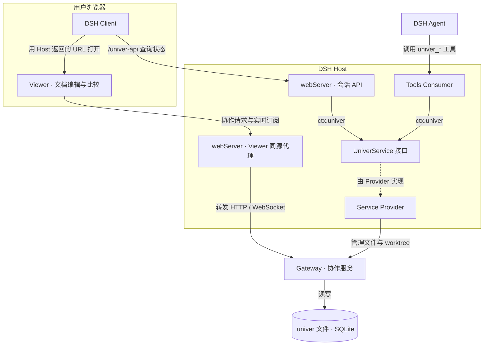
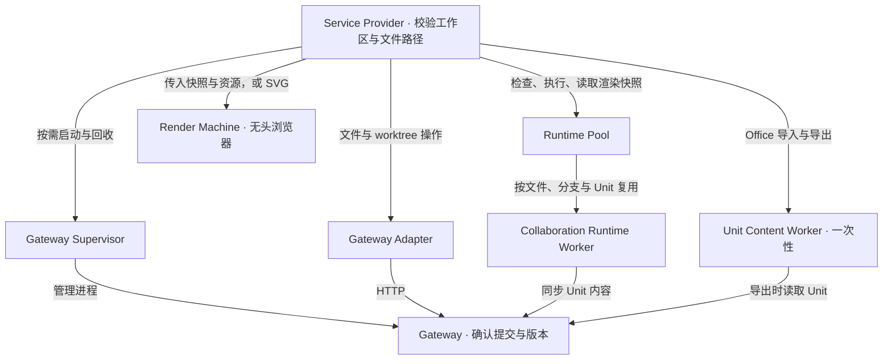

# DSH × Univer 架构总览

本插件以单个 DSH bundle 交付。Agent 和用户通过不同入口操作同一份 `.univer` 文件：Host 提供会话服务，Gateway 管理文档与版本，Worker 处理 Unit 内容，浏览器中的 Viewer 展示文档。初次阅读可以先顺着下图走一遍，再从文末索引进入负责该行为的模块。

## 文档的两个入口

**Agent 修改文档。** 模型通过 DSH Skill Registry 加载随包工作流，调用工具，经 `ctx.univer` 进入 Provider。Provider 校验工作区与目标文件，调用 Worker 执行指定 Unit 的修改，Gateway 确认提交。工具把文件、worktree 和 Unit 标识写入可回放的会话事件。

**用户打开预览。** DSH Client 从会话事件或文件树获得目标，向 Host 查询当前状态，用 Host 授权的 URL 打开 Viewer。Viewer 的 HTTP 请求和 WebSocket 通过 DSH 同源代理到达 Gateway，多个 Viewer 可以订阅同一文档。

## 进程与职责

Host 中的 Tools 与会话 API 都依赖 `UniverService`，由 Provider 实现。Provider 管理子进程的生命周期和工作区文件操作。Gateway 对文档内容、worktree 与 revision 负责，使用 SQLite 存储。Worker 经 Gateway 同步内容，Render Machine 接收 Provider 装配的渲染输入。Client 与 Host 通过可序列化的 wire 数据通信。

Host 按会话文件策略授权工具操作、状态查询和 Viewer 文档打开。后续 Viewer 文件 API 与 WebSocket 使用 DSH 连接鉴权，已认证浏览器可访问 Host 进程有权打开的文件。完整边界见 [Viewer 同源部署](operations/viewer-same-origin.md)。

## 模块索引

| 想了解的问题 | 阅读入口 |
| --- | --- |
| 谁授权文件访问、提供会话 API、维护缓存和启动 Gateway？ | [Host 服务](modules/host-service.md) |
| 模型怎样获得工具，哪些操作需要审批？ | [Agent 工具与技能](modules/agent-integration.md) |
| 浮窗何时打开或关闭？回合卡片和文件树如何选择目标？ | [Client 预览与审阅](modules/client-preview-and-review.md) |
| 页面如何呈现 Unit、处理焦点并展示两个版本的差异？ | [Viewer](modules/viewer.md) |
| 谁确认提交、持久化历史、处理 worktree 与比较会话？ | [Gateway](modules/gateway.md) |
| 哪些任务复用 Worker？Office 文件如何导入导出？ | [Unit 内容与 Worker](modules/unit-content.md) |
| 快照和引用资源如何生成布局检查结果、PNG 或 PDF？ | [渲染与输出](modules/rendering.md) |
| SVG 资源如何查找、缓存和导出？ | [SVG 资源库](modules/resource-library.md) |
| 采集哪些匿名事件，如何禁用？ | [产品遥测](modules/telemetry.md) |
| 桌面壳和远程浏览器怎样访问本机 Gateway？ | [Viewer 同源部署](operations/viewer-same-origin.md) |
| 应用如何构建和发布，SDK 版本如何配套？ | [构建与发布](operations/build-and-release.md) |

文档与代码的同步规则、开发命令及验证范围见 [AGENTS.md](../AGENTS.md)。
